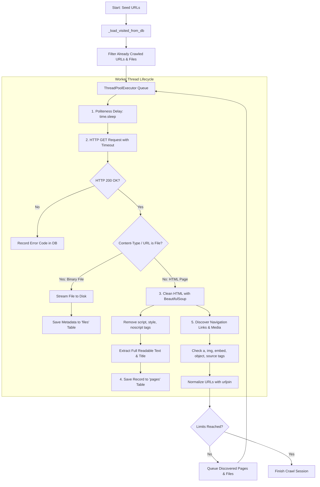

# SQLite Web Crawler & Multi-Format File Downloader

A robust, multi-threaded web crawler written in Python that crawls websites, extracts clean readable textual content, downloads any specified file formats (such as **.pdf**, **image formats**, **.swf**, **documents**, **media**, or custom extensions), and stores metadata persistently into a local SQLite database (`crawler.db`).

---

## Table of Contents
- [How It Works (Architecture & Lifecycle)](#how-it-works-architecture--lifecycle)
- [How Breadth-First Search (BFS) Works](#how-breadth-first-search-bfs-works)
- [Database Schema](#database-schema)
- [Key Features](#key-features)
- [What You Learn From This Crawler](#what-you-learn-from-this-crawler)
- [Installation & Setup](#installation--setup)
- [Usage Guide](#usage-guide)
  - [Text Crawling (Default)](#basic-crawl-default-seed)
  - [Downloading Files (.pdf, images, .swf, etc.)](#downloading-files-pdf-images-swf-etc)
  - [File Presets & Wildcards](#file-presets--wildcard-support)
  - [Custom Output Directory & Limits](#custom-download-folder--limits)
- [Visualizing & Understanding the Data](#visualizing--understanding-the-data)

---

## How It Works (Architecture & Lifecycle)

The crawler operates as a **dynamic multi-threaded breadth-first graph traversal engine** with concurrent file downloading:



### Step-by-Step Execution Flow:

1. **Database Schema Initialization (`_init_db`)**:
   - Creates `crawler.db` with two tables: `pages` (for text content) and `files` (for downloaded file metadata).

2. **Session Resumption & Deduplication (`_load_visited_from_db`)**:
   - Queries `SELECT url FROM pages` and `SELECT url FROM files` to populate in-memory `visited` and `visited_files` sets.
   - Any URL already crawled or downloaded in prior sessions is skipped in $O(1)$ time.

3. **Multi-threaded Worker Pool (`ThreadPoolExecutor`)**:
   - Dispatches worker threads concurrently (default: `max_workers=5`).
   - Dynamically balances HTML page extraction and binary file streaming downloads.

4. **Politeness & Network Fetching (`crawl_page` & `download_file`)**:
   - Sleeps for a configurable duration (`delay=0.5s`) to respect target web servers.
   - Sends an HTTP `GET` request with a descriptive `User-Agent` and strict network timeouts.

5. **Resource Inspection & Content Extraction**:
   - **For HTML pages**: Strips non-content tags (`<script>`, `<style>`, `<noscript>`, `<svg>`) and extracts clean text into SQLite `pages`.
   - **For Target Files (`.pdf`, images, `.swf`, etc.)**: Streams file contents in 64KB chunks to protect RAM, sanitizes filenames to prevent filesystem errors, and saves metadata into SQLite `files`.

6. **Comprehensive Resource Discovery**:
   - **Page Links**: Outgoing `<a href="...">` links that navigate to new HTML pages are queued for BFS traversal.
   - **Files**: Inspects `<a href>`, ``, `<embed src>`, `<object data>`, `<param name="movie">`, and `<source src>` tags. Any target matching allowed extensions is scheduled for streaming download.

---

## How Breadth-First Search (BFS) Works

### 1. The Web as a Directed Graph
- **Nodes** = Web pages and resources (URLs)
- **Edges** = Hyperlinks and media tags (`<a>`, ``, `<embed>`, `<object>`)

```
          [ Seed URL ]                 <-- Level 0 (Start)
          /    |     \
     [Link A] [Link B] [File: report.pdf]   <-- Level 1 (Links & files on Seed)
      /   \      |        
   [Link D]... [File: game.swf]             <-- Level 2 (Discovered inside A, B)
```

In **Breadth-First Search (BFS)**, all immediate sibling pages and resources at depth level $k$ are processed before diving deeper into level $k+1$.

---

## Database Schema

All data is stored locally in `crawler.db`:

### `pages` Table (Text Content)
| Column | Type | Description |
| :--- | :--- | :--- |
| `id` | `INTEGER PRIMARY KEY` | Auto-incrementing unique row identifier. |
| `url` | `TEXT UNIQUE` | Normalized URL of the crawled web page. |
| `title` | `TEXT` | Extracted `<title>` tag from the HTML document. |
| `content` | `TEXT` | Complete clean readable textual content. |
| `status_code` | `INTEGER` | HTTP response code (e.g., `200`, `404`, `500`). |
| `crawled_at` | `TIMESTAMP` | Timestamp of when the page was crawled. |

### `files` Table (Downloaded Files)
| Column | Type | Description |
| :--- | :--- | :--- |
| `id` | `INTEGER PRIMARY KEY` | Auto-incrementing unique row identifier. |
| `url` | `TEXT UNIQUE` | Unique URL of the downloaded file. |
| `file_path` | `TEXT` | Local absolute file path on disk. |
| `file_name` | `TEXT` | Sanitized filename. |
| `file_type` | `TEXT` | File extension (e.g., `.pdf`, `.swf`, `.png`, `.jpg`). |
| `file_size` | `INTEGER` | Size of the file in bytes. |
| `mime_type` | `TEXT` | Content-Type header reported by the server. |
| `source_page` | `TEXT` | URL of the HTML page where the file was discovered. |
| `status_code` | `INTEGER` | HTTP status code. |
| `downloaded_at` | `TIMESTAMP` | Timestamp when the file was downloaded. |

---

## Key Features

- **Multi-Format File Support**: Specify any file extensions (`.pdf`, images, `.swf`, `.zip`, `.mp4`, etc.) or presets.
- **Embedded Media Detection**: Extracts files from `<a href>`, ``, `<embed src>`, `<object data>`, `<param name="movie">`, and `<source src>` tags.
- **Streaming Downloader**: Streams files in 64KB chunks to protect RAM.
- **Extension & Content-Type Validation**: Accurately distinguishes genuine file extensions from URL slugs containing periods (such as version numbers `/v1.0/` or decimal measurements like `6.3-inch-display`), and verifies server `Content-Type` headers to prevent web pages from being downloaded as raw files.
- **Content-Disposition Support**: Reads server-provided attachment filenames and extensions directly from HTTP headers when available.
- **Safe Filename Sanitization**: Protects against path traversal, illegal characters, and Windows reserved filenames (CON, PRN, AUX, etc.).
- **Multi-threaded Concurrency**: Concurrently crawls pages and downloads files using `ThreadPoolExecutor`.
- **Deduplication & Session Resumption**: Remembers both visited pages and downloaded files across runs in SQLite.
- **Zero Text Loss**: Stores 100% of readable HTML text into SQLite.

---

## Installation & Setup

1. Open your terminal in the project directory:
   ```bash
   cd "Web Crawler Project"
   ```
2. Install dependencies:
   ```bash
   pip install -r requirements.txt
   ```

---

## Usage Guide

### Basic Crawl (Default: Downloads All Files & Saves Text)
Run the crawler directly on any URL. It starts crawling and downloading all discovered files automatically:
```bash
python crawler.py https://example.com
```

> **Default Behavior**: By default (`DEFAULT_FILE_TYPES = "all"`), the crawler extracts all clean page text into SQLite and downloads all files (`.pdf`, images, `.swf`, media, etc.) into the `downloads/` folder.

---

### Downloading Only Specific File Formats (.pdf, images, .swf, etc.)
Use `--file-types` (or `-f`) to specify only the formats you want:

```bash
# Download .pdf and .swf files:
python crawler.py https://example.com --file-types .pdf .swf

# Download images and .pdf:
python crawler.py https://example.com -f .png .jpg .pdf

# Download Flash files (.swf), vector graphics (.svg), and documents (.pdf):
python crawler.py https://example.com -f .swf .svg .pdf
```

### File Presets & Wildcard Support
For convenience, use pre-configured presets:

| Preset | Extensions Included |
| :--- | :--- |
| `images` | `.jpg`, `.jpeg`, `.png`, `.gif`, `.webp`, `.svg`, `.bmp`, `.ico`, `.tiff`, `.avif` |
| `docs` | `.pdf`, `.doc`, `.docx`, `.xls`, `.xlsx`, `.ppt`, `.pptx`, `.txt`, `.rtf`, `.csv` |
| `flash` | `.swf`, `.flv`, `.spl` |
| `media` | `.mp3`, `.mp4`, `.wav`, `.avi`, `.mov`, `.mkv`, `.ogg`, `.webm`, `.flac` |
| `archives` | `.zip`, `.tar`, `.gz`, `.rar`, `.7z`, `.bz2`, `.xz` |
| `all` or `*` | Any non-HTML file format |

Examples:
```bash
# Download all image formats:
python crawler.py https://example.com -f images

# Combine presets and specific extensions:
python crawler.py https://example.com -f images .pdf .swf

# Download any file format encountered:
python crawler.py https://example.com -f all
```

### Custom Download Folder & Limits
```bash
# Save files to a custom directory with a safety cap of 50 files:
python crawler.py https://example.com -f images,pdf -o my_downloads --max-files 50 --max-pages 20
```

### All CLI Options
```
python crawler.py [-h] [--file-types FILE_TYPES [FILE_TYPES ...]]
                  [--download-dir DOWNLOAD_DIR] [--max-pages MAX_PAGES]
                  [--max-files MAX_FILES] [--max-workers MAX_WORKERS]
                  [--delay DELAY] [--db-path DB_PATH] [--non-interactive]
                  [seeds ...]
```

---

## Visualizing & Understanding the Data

To inspect both crawled text and downloaded files, run the visualizer tool:

```bash
python visualize.py
```

This will:
1. **Print an instant CLI summary**:
   - Total pages crawled and average page length
   - Total files downloaded and total storage consumed (in KB/MB)
   - Breakdown of downloaded file formats (e.g. `.pdf`: 12, `.png`: 35, `.swf`: 4)
   - Top domains and keywords
2. **Generate `report.html` and launch the visual dashboard in your browser**:
   - **KPI Cards**: Pages, files downloaded, storage size, success rates
   - **Interactive Charts**: Keywords frequency, domain distribution, downloaded file types breakdown
   - **Crawled Pages Explorer**: Searchable table of all web pages with content snippets
   - **Downloaded Files Explorer**: Searchable table showing file formats, formatted sizes, remote URLs, local storage paths, and source pages.
