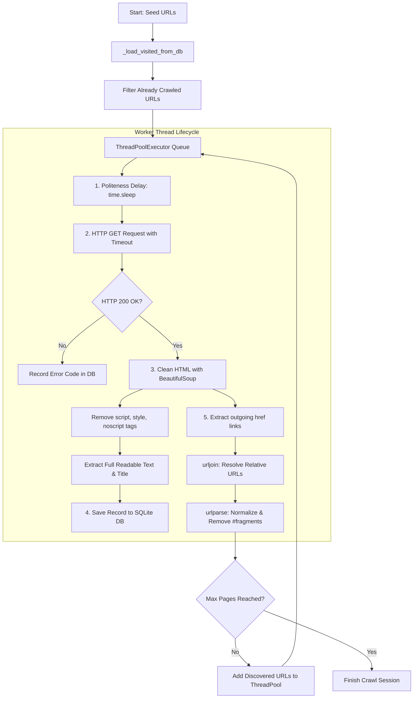

# SQLite Web Crawler

A robust, multi-threaded web crawler written in Python that crawls websites, extracts clean readable textual content, and stores records directly into a local SQLite database (`crawler.db`).

---

## Table of Contents
- [How It Works (Architecture & Lifecycle)](#how-it-works-architecture--lifecycle)
- [How Breadth-First Search (BFS) Works](#how-breadth-first-search-bfs-works)
- [Database Schema](#database-schema)
- [Key Features](#key-features)
- [What You Learn From This Crawler](#what-you-learn-from-this-crawler)
- [Installation & Setup](#installation--setup)
- [Usage Guide](#usage-guide)
- [Visualizing & Understanding the Data](#visualizing--understanding-the-data)

---

## How It Works (Architecture & Lifecycle)

The crawler operates as a **dynamic multi-threaded breadth-first graph traversal engine**:



### Step-by-Step Execution Flow:

1. **Database Schema Initialization (`_init_db`)**:
   - Checks if `crawler.db` and the `pages` table exist. If not, it creates them with `url TEXT UNIQUE`.

2. **Session Resumption & Deduplication (`_load_visited_from_db`)**:
   - Queries `SELECT url FROM pages` and populates an in-memory `visited = set()`.
   - Any URL that was crawled in previous sessions is skipped instantly in $O(1)$ time, preventing duplicate work.

3. **Multi-threaded Worker Pool (`ThreadPoolExecutor`)**:
   - Instead of crawling one page at a time (which is slow due to network latency), the crawler runs multiple concurrent worker threads (default: `max_workers=5`).
   - Tasks are tracked via asynchronous `concurrent.futures`.

4. **Politeness & Network Fetching (`crawl_page`)**:
   - Each thread sleeps for a configurable duration (`delay=0.5s`) to avoid flooding or crashing target web servers.
   - Sends an HTTP `GET` request with a custom `User-Agent` and a strict 10-second timeout.

5. **Content Extraction & Cleaning (`BeautifulSoup`)**:
   - Non-content markup such as `<script>`, `<style>`, `<noscript>`, `<svg>`, `<header>`, and `<footer>` tags are stripped out.
   - Extracts all visible body text cleanly using `soup.get_text(separator=' ', strip=True)`.

6. **SQLite Storage (`_save_to_db`)**:
   - Inserts or updates the record into `crawler.db` with the URL, title, complete text content, HTTP status code, and crawl timestamp.

7. **URL Normalization & Expansion**:
   - Finds all `<a href="...">` links on the page.
   - Converts relative URLs (e.g., `/articles/news`) into absolute links (`https://example.com/articles/news`) using `urljoin`.
   - Strips URL fragments (`#comments`) so duplicate section anchors are treated as one unique page.
   - Newly discovered URLs are queued back into the active thread pool until the `max_pages` limit is reached.

---

## How Breadth-First Search (BFS) Works

### 1. The Web as a Directed Graph
- **Nodes** = Web pages (URLs)
- **Edges** = Hyperlinks (`<a href="...">`)

```
          [ Seed URL ]                 <-- Level 0 (Start)
          /    |     \
     [Link A] [Link B] [Link C]        <-- Level 1 (Immediate links on Seed)
      /   \      |        \
   [Link D]... [Link E]   [Link F]     <-- Level 2 (Links found inside A, B, C)
```

In graph theory, **Breadth-First Search (BFS)** traverses all neighbor nodes at current depth level $k$ before proceeding to explore deeper nodes at level $k+1$.

### 2. Implementation in Code
In `crawler.py`, the BFS queue is managed concurrently through Python's `ThreadPoolExecutor`:
1. **Level 0 Dispatch**: The seed URL is submitted first:
   ```python
   futures = {executor.submit(self.crawl_page, url): url for url in urls_to_crawl}
   ```
2. **Discovering Level 1 Links**: Once the seed page finishes, all links found on it (`Link A`, `Link B`, `Link C`) are extracted.
3. **Queueing to the Back (FIFO)**:
   ```python
   with self.lock:
       for link in new_links:
           if link not in self.visited and (len(futures) + crawled_count) < self.max_pages:
               self.visited.add(link)
               # Appends to the back of the ThreadPool queue
               futures[executor.submit(self.crawl_page, link)] = link
   ```
   Newly discovered links are scheduled at the **tail** of the executor's task queue. As a result, all sibling pages (Level 1) are crawled before the crawler dives deeper into child pages (Level 2).

### 3. Why BFS is Preferred over DFS for Web Crawlers

| Feature | BFS (Breadth-First Search) | DFS (Depth-First Search) |
| :--- | :--- | :--- |
| **Exploration Strategy** | Discovers broad, diverse content across the site first. | Dives deep into a single narrow chain of pages. |
| **Trap Resistance** | Highly resistant to spider traps and infinite URL recursion loops. | Can get trapped in infinite calendar/archive loops indefinitely. |
| **Page Importance** | Prioritizes top-level pages (homepages, category menus) where the most valuable links reside. | Might index thousands of low-value leaf pages before touching main sections. |

---

## Database Schema

All data is stored locally in `crawler.db` inside the `pages` table:

| Column | Type | Description |
| :--- | :--- | :--- |
| `id` | `INTEGER PRIMARY KEY` | Auto-incrementing unique row identifier. |
| `url` | `TEXT UNIQUE` | Normalized URL of the crawled page. |
| `title` | `TEXT` | Extracted `<title>` tag from the HTML document. |
| `content` | `TEXT` | Complete clean readable textual content extracted from the page. |
| `status_code` | `INTEGER` | HTTP response code (e.g., `200` for success, `404`, `500`, etc.). |
| `crawled_at` | `TIMESTAMP` | ISO timestamp of when the page was crawled. |

---

## Key Features

- **Multi-threaded Concurrency**: Scales scraping performance with concurrent worker threads.
- **Deduplication & Resumption**: Never visits the same URL twice, even across multiple program restarts.
- **Zero Data Loss**: Stores 100% of the extracted text content directly in SQLite.
- **Server-Polite**: Built-in delay mechanism and custom User-Agent headers.
- **Fault-Tolerant**: Network timeouts, DNS errors, or HTTP errors are caught and logged without crashing the crawler.

---

## What You Learn From This Crawler

Building and analyzing this project teaches fundamental software engineering and distributed systems concepts:

### 1. Concurrent Programming & Thread Safety
- **Multi-threading with `ThreadPoolExecutor`**: How to run multiple network I/O operations simultaneously without blocking main program execution.
- **Race Condition Prevention (`threading.Lock`)**: Why shared state (such as tracking visited URLs across worker threads) requires synchronization to prevent duplicate requests or corrupted memory.

### 2. Graph Algorithms & Traversal in Practice
- **The Web as a Graph**: Applying **Breadth-First Search (BFS)** to real-world network data where web pages are nodes and links are directed edges.
- **URL Normalization & Hygiene**: How to handle edge cases like relative paths (`/about`), protocol differences (`http` vs `https`), and stripping anchor fragments (`#comments`) to avoid infinite crawl loops.

### 3. Resilient Data Pipeline & Idempotency
- **Persistent State across Crashes**: How checking the database at startup and using `INSERT OR REPLACE` ensures idempotency—the crawler can be paused, interrupted, or restarted at any time without duplicating work.
- **DOM Parsing & Text Cleansing**: Using `BeautifulSoup` to strip non-content tags (`<script>`, `<style>`, `<noscript>`, `<svg>`) to generate clean plain text suitable for NLP, search indexing, or LLM/RAG pipelines.

### 4. Real-World Applications & Industry Use Cases
- **Search Engines**: Web crawlers form the foundation of indexing engines like Google and Bing.
- **AI & LLM Training / RAG**: Gathering clean offline training corpora and contextual knowledge bases for Retrieval-Augmented Generation.
- **Market Intelligence**: Price comparison engines, competitive product tracking, and job board aggregators.
- **SEO & Site Health Auditing**: Discovering broken internal links (404/500 status codes), missing titles, or redirect chains across a website.

---

## Installation & Setup

1. Open your terminal in the `web-crawler` folder:
   ```bash
   cd web-crawler
   ```
2. Install the required dependencies:
   ```bash
   pip install -r requirements.txt
   ```

---

## Usage Guide

### Basic Crawl (Default Seed)
To run the crawler with the default starting URL:
```bash
python crawler.py
```

### Custom Seed URLs
Pass one or more starting URLs directly as command-line arguments:
```bash
python crawler.py https://news.ycombinator.com/
```

Or multiple starting seeds:
```bash
python crawler.py https://en.wikipedia.org/wiki/Web_crawler https://news.ycombinator.com/
```

### Adjusting Limits
Inside `crawler.py`, you can customize parameters in the `__init__` method:
- `max_workers=5`: Number of simultaneous threads.
- `max_pages=100`: Maximum pages to crawl in one run.
- `delay=0.5`: Delay in seconds between requests per thread.

---

## Visualizing & Understanding the Data

To analyze the stored data without needing any external viewer apps, run the included visualizer tool:

```bash
python visualize.py
```

This will:
1. **Print an instant CLI summary**: Page count, status code ratios, top domains, and frequent keywords.
2. **Generate `report.html`**: An interactive dashboard with Chart.js keyword charts, domain breakdown, and a live searchable table of all records.
